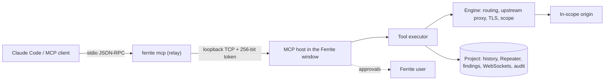

# MCP server

Ferrite includes a native [Model Context Protocol](https://modelcontextprotocol.io) server, so MCP clients such as Claude Code and Cursor can inspect Ferrite's live project and send requests through its engine. Results appear in the AI client; traffic, Repeater tabs and an audit trail appear in Ferrite.

The server exposes tools only. It contains no LLM integration, makes no decisions for the client, and sends nothing anywhere on its own.

## Quick start with Claude Code

1. Start Ferrite and open **MCP** in the sidebar.
2. Select **Enable MCP server**. The status shows `Listening on 127.0.0.1:<port> (loopback only, token required)`.
3. Register Ferrite with Claude Code (the MCP page shows this command with your executable path and a **Copy** button):

   ```sh
   claude mcp add ferrite -- /path/to/ferrite mcp
   ```

   Or add it to a project's `.mcp.json` (see [examples/mcp.json](examples/mcp.json)):

   ```json
   {
     "mcpServers": {
       "ferrite": { "command": "/path/to/ferrite", "args": ["mcp"] }
     }
   }
   ```

4. Start Claude Code. The MCP page lists it under **Connected clients**.
5. Ask, for example:
   - "Using Ferrite, summarise the in-scope endpoints and which take parameters."
   - "Show me the last POST to /login in Ferrite and resend it with the username changed to bob."
   - "Search Ferrite's history for responses that contain stack traces."

When Claude sends a request, Ferrite asks you to approve it (default **Ask each time**), records it in History with the tool `MCP`, and lists the call in the **Audit trail**.

## Architecture



- **Protocol**: the official Rust SDK [`rmcp`](https://github.com/modelcontextprotocol/rust-sdk) handles JSON-RPC, protocol version negotiation (2024-11-05 through 2026-07-28), `ping` and cancellation. Ferrite implements `tools/list` and `tools/call`.
- **Relay (`ferrite mcp`)**: the process the MCP client launches. It never opens the project database. It reads the endpoint file, authenticates to the running Ferrite window and forwards tool calls. If Ferrite is not running, tools return a clear error and the relay reconnects on the next call, so Ferrite can be started after the client.
- **Bridge**: the Ferrite window listens on a random `127.0.0.1` port and writes `{address, token, pid}` to `mcp-endpoint.json` in Ferrite's configuration directory (`<config dir>/ferrite`, or `FERRITE_CONFIG_DIR`) (mode `0600` on Unix; per-user `%APPDATA%` on Windows). The relay must present the 256-bit token, compared in constant time. Messages are newline-delimited JSON with size limits. The file is removed when MCP is disabled or Ferrite exits. A second Ferrite instance refuses to take over a live endpoint.
- **Host**: tools always target the project currently open in the window, including after you switch projects. Long reads (history scans, searches, site maps) run on blocking threads with a lock-free snapshot reader, so they never stall proxy recording or the UI.
- **Headless mode**: `ferrite mcp --headless --project FILE` runs the engine without a window and serves MCP on stdio directly. redb locks the project file, so the GUI and a headless server can never open the same project at once.
- **Future transports**: tools are executed by a transport-independent `Backend`, so an authenticated loopback Streamable HTTP transport (rmcp's `transport-streamable-http-server`) can be added without changing tool code.

## Security model

| Control | Behaviour |
| --- | --- |
| Opt-in | Disabled until enabled on the MCP page. The setting is application-wide |
| Network exposure | The bridge binds `127.0.0.1` only, on a random port, and requires the token from the user-only endpoint file. Stdio needs no network listener |
| Scope | `send_http_request` and `start_active_scan` refuse URLs outside the target scope, regardless of **Drop out of scope**. The check runs inside the engine against the same settings snapshot as the send, and absolute-form request lines must match the target origin. Only the Ferrite user can change scope |
| Permissions | **Send HTTP requests** defaults to *Ask each time*; **Active scans** defaults to *Deny*. Each can be *Deny*, *Ask each time* or *Allow*. Approvals offer *Allow once*, *Allow for this session* (revoked when MCP is disabled or Ferrite exits) and *Deny*; unanswered requests are denied after two minutes |
| Rate limits | 60 requests per minute and 4 concurrent requests by default (configurable). Each connection is limited to 8 concurrent tool calls; calls time out after five minutes; large reads are paged |
| Credentials | Values of `Cookie`, `Set-Cookie`, `Authorization`, `Proxy-Authorization`, API key and session/CSRF token headers are returned as `[REDACTED]` unless the user enables **Return Cookie, Authorization and similar header values**. A client can keep `[REDACTED]` in a request sent with `tab_id` or `base_exchange_id`, and Ferrite substitutes the original value locally. Bodies are not redacted |
| Secrets never exposed | Upstream proxy credentials, the CA private key and Ferrite's settings are never returned |
| Untrusted data | Server instructions, tool descriptions and a `notice` field on every result that carries captured content tell the client that captured traffic is data, not instructions |
| Audit | Every call is stored in the project's `mcp_audit` table: time, client, tool, a brief argument summary (request bodies are never stored), outcome, duration and created exchange IDs. The MCP page shows recent entries |
| Headless | No window means no approvals: *Ask* behaves as *Deny*. Use `--allow-requests` / `--allow-active-scans` to pre-authorise, still limited to scope |

Captured traffic returned to a client may be sent by that client to its model provider. Enable MCP only for projects where that is acceptable.

## Tools

All tools return JSON as text content (and as `structuredContent`). Errors are tool errors (`isError: true`) with an `error` message. Unknown arguments are rejected.

### Project and scope

| Tool | Arguments | Returns |
| --- | --- | --- |
| `get_project_info` | – | Name, path, storage, counts of exchanges/WebSocket sessions/findings/scans/Repeater tabs, CA fingerprint, version, MCP mode and permissions |
| `get_proxy_status` | – | Listener state and address, interception state, pending interceptions, invisible mode, upstream kind/host/port (no credentials), TLS verification, timeouts and limits |
| `get_scope` | – | Include/exclude regular expressions and scope options |
| `is_url_in_scope` | `url` | `in_scope` with the patterns that matched |

### HTTP history

| Tool | Arguments | Returns |
| --- | --- | --- |
| `list_http_history` | Filters: `host`, `method`, `status` (`404` or `"4xx"`), `mime`, `tool`, `url_contains`, `in_scope_only`, `has_error`; `limit` (≤200), `cursor` | Summaries newest first (ID, time, tool, method, URL, status, MIME, sizes, duration, scope, error) and `next_cursor` |
| `get_http_request` / `get_http_response` | `id`, `format` (`parsed` or `raw`), `offset`, `max_bytes` (≤1 MiB, default 64 KiB), `encoding` (`auto`, `text`, `base64`) | Start line, headers and a body chunk (or the raw message chunk) |
| `search_http_history` | `query`, `regex`, `case_sensitive`, `part` (`all`, `url`, `request`, `response`), `context_bytes`, filters, `limit`, `cursor` | Matching summaries with up to three snippets each |

**Byte fidelity.** Stored message bytes are returned unchanged except for header redaction. A chunk is `{"encoding": "utf-8" | "base64" | "utf-8-lossy", "data", "offset", "length", "total_length", "truncated"}`. With `auto`, printable UTF-8 is returned as text (a page boundary inside a multi-byte character shortens the page rather than corrupting it) and anything else as base64. Page through large bodies with `offset`. Ferrite stores responses after decoding gzip/deflate content encodings, as shown in History.

Each call examines at most 50,000 exchanges (searches also stop after 256 MiB); continue with `next_cursor`.

### Site map

| Tool | Arguments | Returns |
| --- | --- | --- |
| `get_site_map` | `host`, `in_scope_only`, `max_depth` (default 8), `max_nodes` (default 1000) | Origins with nested path segments, counts, methods and status codes |
| `list_hosts` | `in_scope_only` | Origins with counts, status classes, scope, first and last seen |
| `list_endpoints` | `host`, `in_scope_only`, `limit`, `cursor` | Method + path combinations with counts, statuses, response types, query and form/JSON body parameter names |

### Repeater

| Tool | Arguments | Returns |
| --- | --- | --- |
| `send_to_repeater` | `exchange_id`, or `request` + `target`; optional `name`, `group` (default `MCP`) | `tab_id`. The tab appears in Ferrite's Repeater immediately. No traffic is sent |
| `list_repeater_tabs` | – | Tabs with ID, name, collection, target, request line and send history |
| `get_repeater_request` | `tab_id` | The tab's current request (credential headers redacted unless allowed) |
| `send_http_request` | `request` (text, LF or CRLF) or `request_base64`; `target` (origin URL); `tab_id`; `base_exchange_id`; `max_response_bytes` | `exchange_id`, URL, status, duration, error and the parsed response |

`send_http_request` uses Ferrite's normal engine path: DNS overrides, upstream HTTP/SOCKS proxy, outbound TLS settings, HTTP/2 negotiation, message limits, timeouts, history recording and passive scanning. Content-Length is recalculated. Match-and-replace rules and interception do not apply (as for Repeater). With `tab_id`, the result is added to the tab's history, and a supplied request replaces the tab's text, so you can follow along in the Repeater page.

### Scanner

| Tool | Arguments | Returns |
| --- | --- | --- |
| `list_scanner_findings` | `min_severity`, `confidence`, `state`, `url_contains`, `offset`, `limit` | Finding summaries |
| `get_scanner_finding` | `id`, `max_evidence_bytes` (default 8 KiB) | Description, remediation, notes and up to 20 evidence exchanges |
| `get_scan_status` | `scan_id` | Jobs with progress counters and live scanner resource use |
| `start_active_scan` | `exchange_ids` (1–50, all in scope) | `scan_id`. Requires the active scan permission; uses the project's scanner configuration, including whether intrusive checks are enabled |
| `cancel_scan` | `scan_id` | Requires the active scan permission |

### WebSockets

| Tool | Arguments | Returns |
| --- | --- | --- |
| `list_websocket_sessions` | `url_contains`, `state`, `offset`, `limit` | Sessions (the session ID is the handshake's exchange ID) |
| `get_websocket_messages` | `session_id`, `after_sequence`, `direction`, `limit`, `max_bytes` | Messages in order with original and, if edited, forwarded payloads |

## Headless mode

```sh
ferrite mcp --headless --project assessment.ferrite
ferrite mcp --headless --project assessment.ferrite --start-proxy --listen 127.0.0.1:8080 --allow-requests
```

| Flag | Effect |
| --- | --- |
| `--project FILE` | Open or create a project and own it exclusively (default: temporary in-memory project) |
| `--start-proxy`, `--listen IP:PORT` | Also run the proxy listener so traffic can be captured while the client works |
| `--allow-requests` | Allow `send_http_request` without approval (still scope-limited) |
| `--allow-active-scans` | Allow starting and cancelling active scans |
| `--include-credentials` | Return credential header values |

Example Claude Code configuration for a headless project:

```json
{
  "mcpServers": {
    "ferrite-headless": {
      "command": "/path/to/ferrite",
      "args": ["mcp", "--headless", "--project", "/path/to/assessment.ferrite"]
    }
  }
}
```

Set scope in the GUI before handing a project to a headless server: a new project's scope is empty, which matches nothing.

## Troubleshooting

| Symptom | Fix |
| --- | --- |
| Tools return "Ferrite is not reachable" | Start Ferrite and enable the MCP server. The error names the endpoint file the relay looked for. Use `ferrite mcp --endpoint-file PATH` or `FERRITE_MCP_ENDPOINT` if you changed its location |
| "Another Ferrite instance is already serving MCP" | Disable MCP in the other window first |
| "outside the target scope" | Add the target in **Target** |
| "disabled for MCP clients" / "denied" | Change the permission on the MCP page, or approve the prompt |
| Headless start fails to open the project | Close the project in the Ferrite window first |

## Testing

`tests/mcp.rs` runs the real `ferrite` binary as an MCP server and speaks JSON-RPC over stdio, as Claude Code does. It covers the relay to a live engine (initialisation, tool listing, every read-only tool family, redaction and server-side restoration, scope enforcement including absolute-URL mismatches, Repeater tab creation and sends, interactive denial, passive scanner findings, audit entries, and the offline error) and headless mode (exclusive project ownership, persistent audit trail, default denial).

```sh
cargo test --test mcp
```
